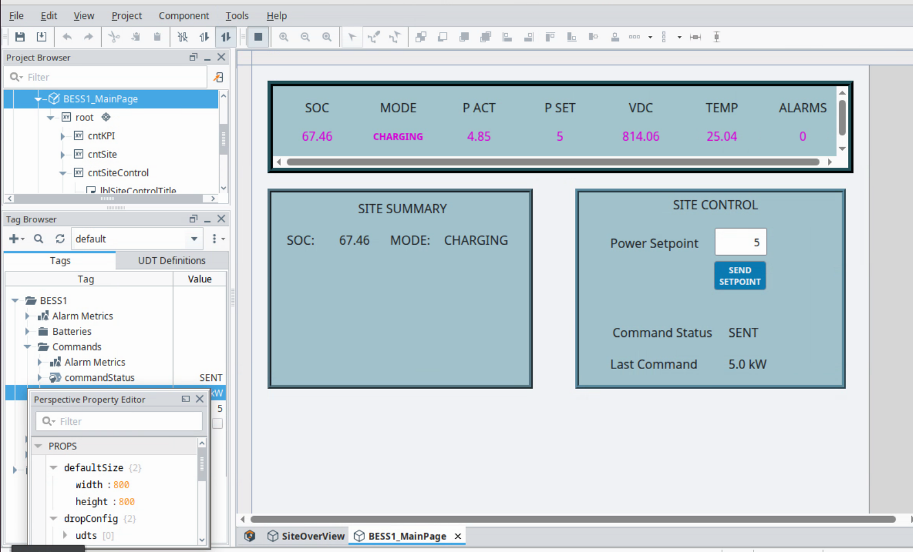
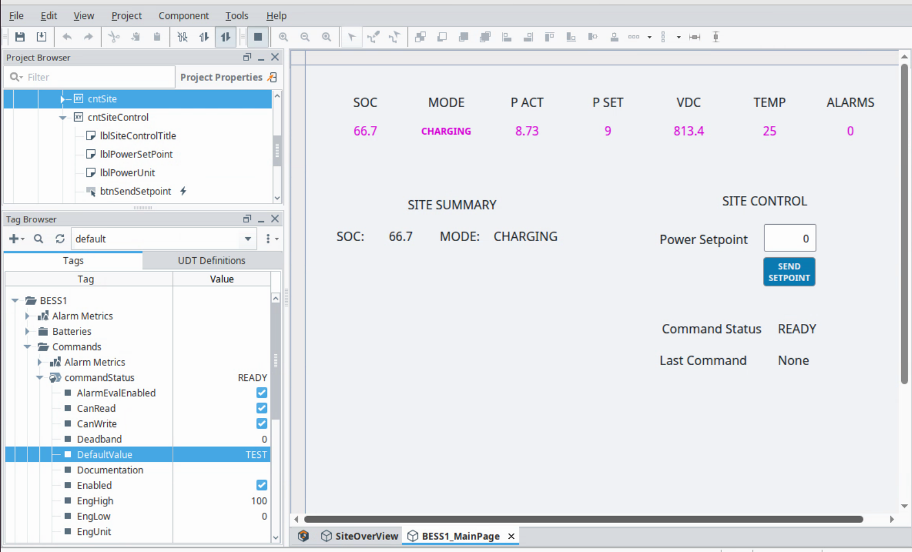
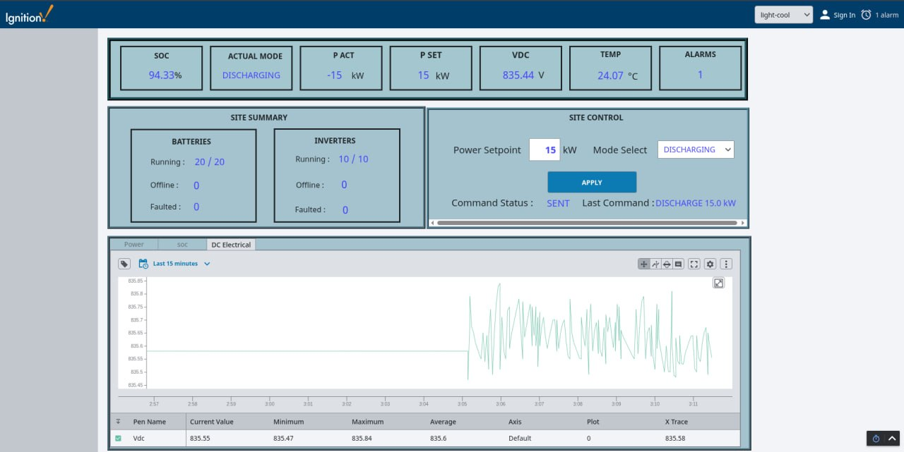
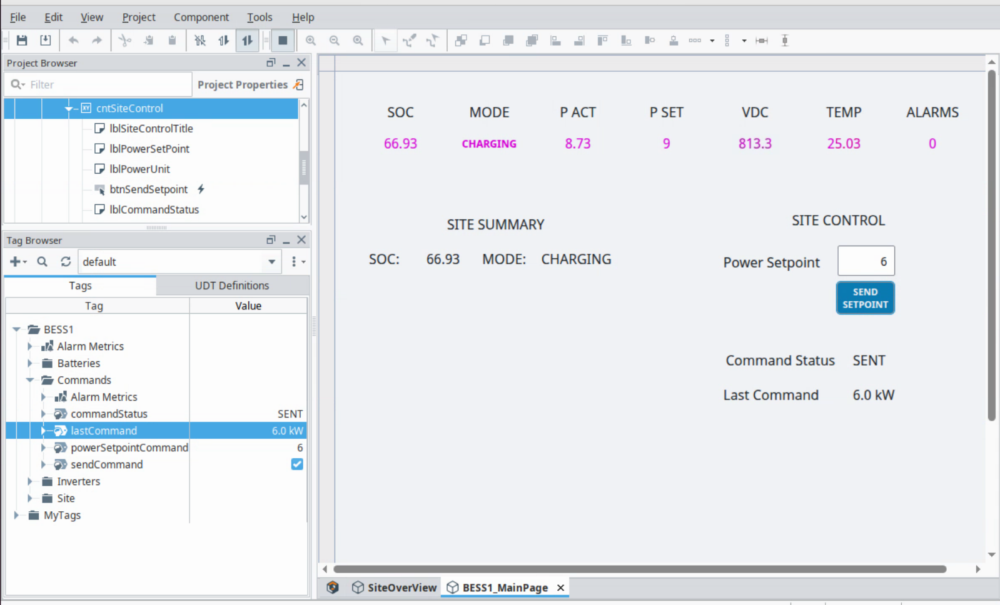
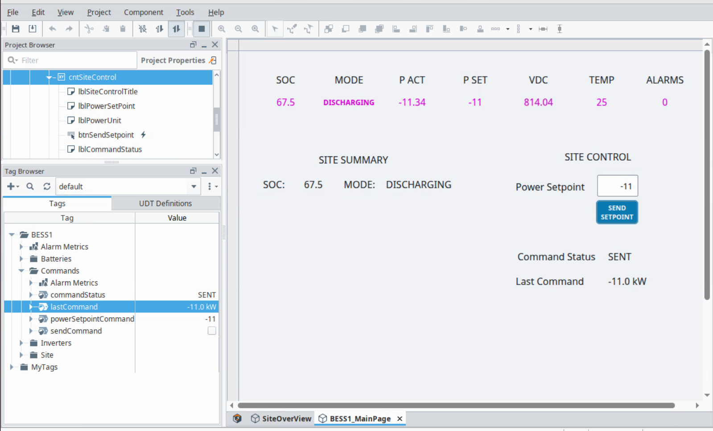
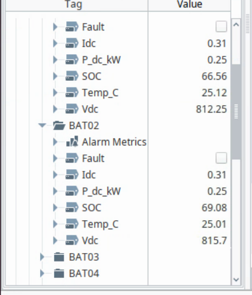
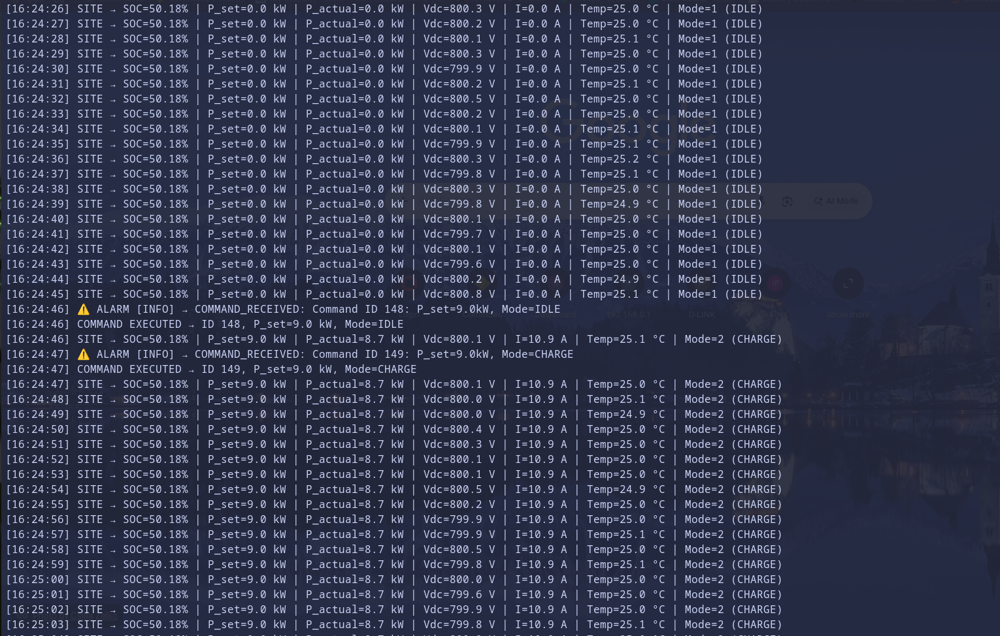

# BESS Digital Twin

A working digital twin of a Battery Energy Storage System (BESS), built as a small
industrial control lab: a plant simulator, a historian database, an OPC UA server,
Ignition SCADA, an energy management system (EMS), an API and Grafana, each on its own
virtual machine.

It exists to practise the whole control stack end to end, the way a real site is put
together: plant → controls → SCADA → operations.



## What it does

- **Simulates a 10-inverter, 20-battery plant** once a second: state of charge, DC voltage
  and current, power, temperatures, faults, and a 50 Hz grid frequency that responds to
  the plant's power.
- **Raises its own alarms** (SOC, temperature, DC bus, current, power shortfall, battery
  imbalance, equipment unavailable) with hysteresis, so they don't chatter.
- **Stores everything** in PostgreSQL + TimescaleDB, with compression, retention and
  long-term downsampling.
- **Publishes it over OPC UA**, including one alarm bit per alarm (see below), and accepts
  charge / discharge / idle commands back from SCADA.
- **Ignition Perspective** shows the plant, trends it, alarms on it, and sends operator
  commands.
- **An EMS** runs time-of-use arbitrage on a simulated market price. It stands down for
  critical alarms and for operator commands, so it never fights the operator.
- **A FastAPI service** exposes site status, fleet data, prices, EMS decisions and commands.
- **Grafana** dashboards read the historian directly.

## Architecture

Five VMs on one Proxmox host. The database is reached over a separate OT network.

```text
  simulator (bsim) ─────► PostgreSQL + TimescaleDB (bessdb) ◄───── EMS + API (bems)
                                 │                ▲          ◄───── Grafana (bmon)
                       telemetry │                │ commands
                                 ▼                │
                          OPC UA bridge (bsim) ───┘
                                 │   ▲
          telemetry, alarm bits  │   │  operator commands        OPC UA, port 4840
                                 ▼   │
                         Ignition SCADA (bscada)
```

| VM | Runs | systemd units |
|---|---|---|
| `bsim` | plant simulator, OPC UA bridge | `bess-simulator`, `bess-opc-bridge` |
| `bessdb` | PostgreSQL 14 + TimescaleDB | |
| `bscada` | Ignition 8.3 (Perspective) | |
| `bems` | EMS, FastAPI | `bess-ems`, `bess-api` |
| `bmon` | Grafana | |

## Alarms: one alarm system

The simulator decides when an alarm is active, as a real battery system or inverter
would, and records it in the `bess_alarms` table. The OPC UA bridge turns that into
**alarm bits**: one true/false tag per alarm, 102 in all.

```text
BESS1/Site/Alarms/SOC_LOW … BATTERY_SOC_IMBALANCE                   12 site alarms
BESS1/Inverters/INV01..INV10/Alarms/TEMP_HIGH, TEMP_CRITICAL, UNAVAILABLE    30
BESS1/Batteries/BAT01..BAT20/Alarms/TEMP_HIGH, TEMP_CRITICAL, UNAVAILABLE    60
```

Ignition puts an alarm on each bit, so every plant alarm appears by name in the alarm
tables and can be acknowledged. Thresholds live in one place only:
`ALARM_THRESHOLDS` in `src/simulator/bess.py`. The catalogue is in
`src/opcua_bridge/alarm_bits.py`, and a test fails if the simulator gains a site alarm
the catalogue doesn't cover.

The alarm bits use fixed string NodeIds (`ns=2;s=BESS1/Site/Alarms/SOC_LOW`) and are
created after all other nodes, so the numeric NodeIds Ignition already uses never move.

## Running it

The lab VMs run from a git checkout at `~/bess-digital-twin`. Install the services:

```bash
sudo bash deployment/systemd/install.sh                    # on bsim: simulator + bridge
sudo bash deployment/systemd/install.sh bess-ems bess-api  # on bems
```

Deploy a change: push from the dev machine, then on the VM:

```bash
cd ~/bess-digital-twin && git pull && sudo systemctl restart bess-opc-bridge
```

Run the tests from the repo root:

```bash
pip install -r requirements.txt -r requirements-dev.txt
python -m pytest -q
```

Credentials live in `config/*.local.env` files, which git ignores. The full operating
procedure is in the [runtime runbook](docs/bess_runtime_runbook.md).

## Repository layout

```text
src/simulator/      plant model: site, inverters, batteries, grid frequency, alarms
src/opcua_bridge/   OPC UA server: telemetry, alarm bits, command write-back
src/ems/            energy management: market price, dispatch strategy
src/api/            FastAPI service
src/database/       schema, client, retention and downsampling
sql/                named queries used by the Ignition dashboard
deployment/         systemd units and installer, logrotate
docs/               runbook, status, evidence and progress notes
tests/              pytest suite
```

## Roadmap

- **Power plant controller (PPC).** Grid frequency model done. Next: a writable grid
  disturbance tag so a "tripped power station" can be triggered from SCADA, then Modbus
  on the simulator and PPC logic in TwinCAT.
- **Alarms.** Ignition alarms on all 102 alarm bits, tested with the simulator's
  alarm-injection table, then the alarm journal for history.
- **SOC balancing** in the EMS, so the batteries' charge levels don't drift apart.
- **OPC UA security**: the server still allows anonymous access.

## Documentation

- [Current status](docs/current_status.md)
- [Runtime runbook](docs/bess_runtime_runbook.md)
- [Portfolio case study](docs/portfolio_case_study.md)
- [API learning guide](docs/api_learning_guide.md)
- Progress notes and test evidence: [docs/progress](docs/progress), [docs/evidence](docs/evidence)

## More screenshots

| | |
|---|---|
|  Site control panel |  Power, SOC and DC trends during a 15 kW discharge |
|  6 kW charge command accepted |  11 kW discharge command accepted |
|  Battery tags in Ignition |  Simulator executing a command |

## Licence

MIT. See [LICENSE](LICENSE).
